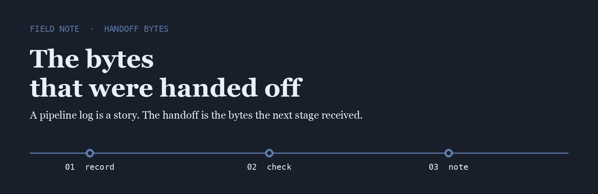
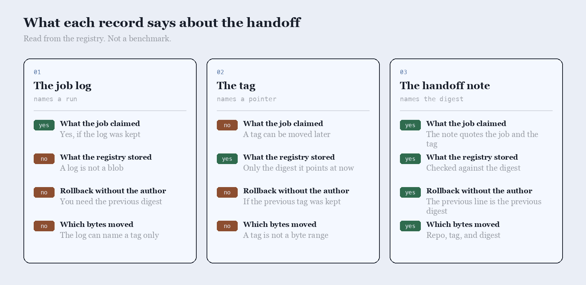

<p align="center">
  
</p>

# Hex Rail

Hex Rail is the name I use when a job says it published an image and the registry has a different digest.

## The question

People trust the job log, the tag, or a note taken from the digest that was pushed. I asked which of those tells you what was handed off.

<p align="center">
  
</p>

|  | The job log | The tag | The handoff note |
| --- | --- | --- | --- |
| What the job claimed | Yes, if the log was kept | A tag can be moved later | The note quotes the job and the tag |
| What the registry stored | A log is not a blob | Only the digest it points at now | Checked against the digest |
| Rollback without the author | You need the previous digest | If the previous tag was kept | The previous line is the previous digest |
| Which bytes moved | The log can name a tag only | A tag is not a byte range | Repo, tag, and digest |

## The line I keep

One line, written after the push and checked by pulling the digest back. The rollback is the previous line.

```text
2026-09-02T06:22:41Z  push  ghcr.io/rail/edge:9f2  sha256:6c1ab80  job  publish  exit 0
```

Registries already know how to store a blob. The gap is a line that says which digest was handed off, written by someone who pulled it.

- [oras](https://github.com/oras-project/oras) moves a set of bytes from one registry to the next
- [distribution](https://github.com/distribution/distribution) is the registry I read when a tag and a digest disagree
- [regclient](https://github.com/regclient/regclient) pulls the digest back so the handoff can be checked

I keep a fork of each on this account.

## What I pay attention to

- A digest copied from the registry, not from the job log
- A tag that still points at that digest the next morning
- A rollback that is the previous digest, not a rerun
- Tools small enough to read in one sitting

## Working with me

Send a short problem statement, a way to see it happen, and what done looks like. I am independent, remote, and usually around during the Helsinki workday.
